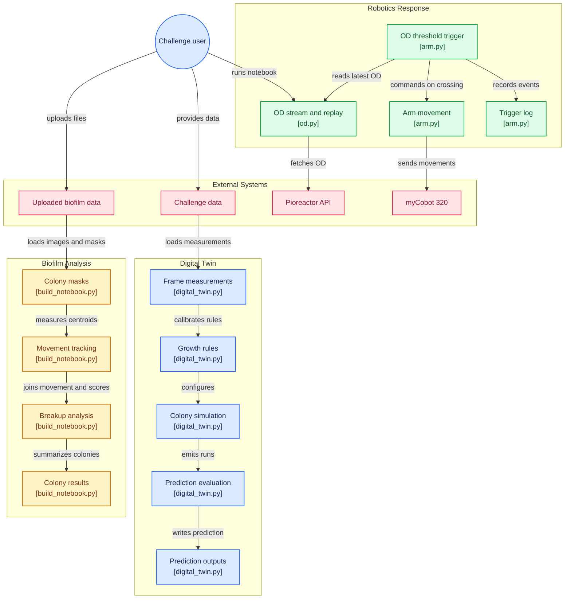
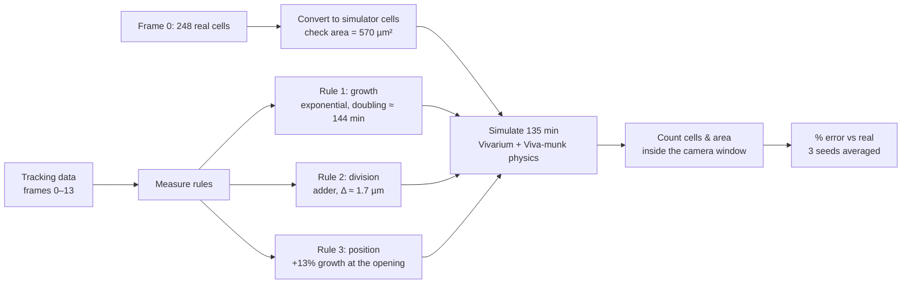
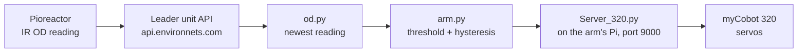

# JSNN Hackathon
## Alex Williams and Brandon Townsend

Our team repo for the JSNN hackathon (Nov 7, 2026). **We placed 2nd in stage 1 and advanced to the final round.** The third challenge, Robotics that Responds, uses a myCobot 320 arm and a Pioreactor provided by the organisers. Each challenge is a self-contained **Google Colab notebook** in its own folder. We built them with AI coding agents (Claude) that coordinated through a GitHub-issue message board.

| Challenge | Folder | Owner | Notebook | Result |
|---|---|---|---|---|
| 1. Digital Twin: simulate an E. coli colony | [`digital-twin/`](digital-twin/) | Alex | [`digital_twin.ipynb`](digital-twin/digital_twin.ipynb) | Predicts cell count within **4.8%** and area within **1.1%** of the real cells · **2nd place, stage 1** |
| 2. Biofilm dispersion: track colonies breaking up | [`biofilm/`](biofilm/) | Brandon | [`biofilm_dispersion.ipynb`](biofilm/biofilm_dispersion.ipynb) | Colony 33 moved farthest (37.2 px); colony 27 had the largest breakup-score increase (+45) |
| 3. Robotics that Responds: live OD → robot arm | [`robotics/`](robotics/) | Brandon (reactor + OD), Alex (arm) | [`robotics.ipynb`](robotics/robotics.ipynb) | **All 5 objectives met:** live bioreactor OD drives the arm; every threshold crossing → exactly one move ([2-min video](robotics/evidence/arm/obj5_run4_realtime_2min.mp4) · [evidence](robotics/PROGRESS.md)) |

**Open in Colab:** Digital Twin [](https://colab.research.google.com/github/alexwilldev/jsnn-hackathon/blob/main/digital-twin/digital_twin.ipynb) · Biofilm [](https://colab.research.google.com/github/alexwilldev/jsnn-hackathon/blob/main/biofilm/biofilm_dispersion.ipynb)

**Poster:** [`poster/JSNN_poster_Williams_Townsend.pptx`](poster/JSNN_poster_Williams_Townsend.pptx) (48 × 36 in, editable) · [preview](poster/JSNN_poster_preview.png)  
**Robot videos:** [2-min real-time demo](robotics/evidence/arm/obj5_run4_realtime_2min.mp4) · [35-s timelapse](robotics/evidence/arm/obj4_obj5_timelapse_test_movement_and_vial_trigger.mp4)

**New here? Read in this order:** this README → [GUIDE.md](GUIDE.md) (what everything means, and how to explain it to judges) → the notebooks.

---

## Contents
1. [What's in the repo](#1-whats-in-the-repo)
2. [Run the notebooks](#2-run-the-notebooks)
3. [How the Digital Twin works](#3-how-the-digital-twin-works)
4. [How the Biofilm notebook works](#4-how-the-biofilm-notebook-works)
5. [How the Robotics challenge works](#5-how-the-robotics-challenge-works)
6. [How we worked: agents, board, git](#6-how-we-worked-agents-board-git)
7. [Learn it: a path for both of us](#7-learn-it-a-path-for-both-of-us)
8. [Known issues](#8-known-issues)

---

## 1. What's in the repo

```
jsnn-hackathon/
├── README.md                 ← you are here: overview, how to run, how to learn it
├── GUIDE.md                  ← plain-language explainer + judge talking points (both challenges)
├── AGENTS.md / CLAUDE.md     ← rules every AI agent follows (board etiquette, branches, ownership)
├── agentwalkthrough.md       ← how the agent message-board framework works (from the template)
│
├── digital-twin/             ← Challenge 1 (Alex)
│   ├── digital_twin.ipynb      THE DELIVERABLE: open this in Colab
│   ├── digital_twin.py         the notebook's source: edit this, not the .ipynb
│   ├── build_notebook.py       turns digital_twin.py into digital_twin.ipynb
│   └── PLAN.md                 the plan we made before writing code (task, data, time budget, risks)
│
├── biofilm/                  ← Challenge 2 (Brandon)
│   ├── biofilm_dispersion.ipynb          THE DELIVERABLE (needs 3 data files uploaded, see §2)
│   ├── biofilm_dispersion_starter.ipynb  the organisers' blank template, for reference
│   ├── build_notebook.py                 fills the starter's TODO cells → the deliverable
│   └── interpretation.md                 the 148-word interpretation (also inside the notebook)
│
├── robotics/                 ← Challenge 3: Robotics that Responds (Brandon: reactor + live OD; Alex: arm)
│   ├── PLAN.md                 1-hour plan: objectives, API, the two-track split, risks
│   ├── od.py                   (Track A) find the experiment, stream live OD, record/replay
│   ├── arm.py                  (Track B) myCobot 320 control, dry-run fallback, OD threshold trigger
│   ├── robotics.ipynb          the combined notebook (runs anywhere in dry-run + replay)
│   ├── run_live.sh             runs the live demo from a terminal, printing every reading
│   ├── build_notebook.py       joins od.py + arm.py → robotics.ipynb
│   ├── PROGRESS.md             each objective, its result, and the evidence file that proves it
│   └── evidence/               photos, videos, run logs, OD log
│
├── poster/                   ← research poster (CAES template, 48 × 36 in)
│   ├── JSNN_poster_Williams_Townsend.pptx   the poster (editable, native charts)
│   ├── JSNN_poster_preview.png              quick-look image of it
│   └── build_poster.py + assets/            regenerates the poster from the project data
│
├── tools/board               ← command-line tool for the agent message board (GitHub issue #1)
├── .claude/                  ← hooks that show new board posts to Claude Code agents
├── .github/ISSUE_TEMPLATE/   ← template for the board issue
│
├── art/                      ← just for fun: a generative-art record of our work
│   ├── snapshot.sh             logs the size of our work once a minute → worklog.jsonl
│   └── render.py               draws worklog.jsonl as hackathon_art.png
│
├── refs/                     ← NOT in git: local copies of the challenge repo, Viva-munk source, biofilm data
└── docs/                     ← images for the docs
```

The `refs/` folder and the Python environment (`digital-twin/.venv`) only exist on the machine that made them. Git ignores them, and the notebooks don't need them because they download what they need themselves.


### Architecture at a glance



*Diagram generated with [GitDiagram](https://gitdiagram.com/alexwilldev/jsnn-hackathon). Blue: Digital Twin · amber: Biofilm · green: Robotics · red: external data and hardware.*

---

## 2. Run the notebooks

### In Google Colab (how judges will see it)
Both notebooks already contain their saved outputs (plots, tables, video), so you can **read them without running anything**. To run one yourself:

**Digital Twin** (downloads its own data):
1. Click the Digital Twin **Open in Colab** badge at the top of this README (or in Colab: **File → Open notebook → GitHub**, paste `alexwilldev/jsnn-hackathon`, pick `digital-twin/digital_twin.ipynb`).
2. Choose **Runtime → Run all**. The first cell installs the exact package versions and downloads the challenge data. If it says the runtime restarts, wait a moment and choose **Run all** again (it only does this once).
3. It takes about 6–10 minutes: the simulation runs 3 random seeds for each set of rules.

**Biofilm** (you supply the data):
1. Click the Biofilm **Open in Colab** badge (or open `biofilm/biofilm_dispersion.ipynb` the same way).
2. Click the **folder icon** on the left and upload `biofilm.zip`, `colony_masks.npz` and `breakup_scores.csv` from the organisers' zip.
3. Choose **Runtime → Run all**.

**Robotics (challenge 3):** the notebook runs anywhere in *dry-run* mode (no arm needed) and replays recorded OD if the live API is down. To drive the real arm, run it on a laptop on the same WiFi as the myCobot, with `ARM_IP=<arm IP>`. See [`robotics/PLAN.md`](robotics/PLAN.md) and [`robotics/PROGRESS.md`](robotics/PROGRESS.md).

#### Moving the myCobot 320 by hand
1. On the arm's Raspberry Pi (SSH in with the arm's default login from its manual), start the control server and leave it running: `python3 ~/Server_320.py`. Wait for "waiting connect". The emergency stop must be plugged in and released.
2. On your laptop (same WiFi), open Python and send one line at a time:

```python
from pymycobot import MyCobot320Socket
mc = MyCobot320Socket("192.168.8.149", 9000)   # the arm's IP address, port 9000
mc.get_angles()                                # current pose: list of 6 joint angles in degrees

mc.send_angles([90, 30, 15, -30, 0, -42], 30)
#               │   │   │    │   │   │    └─ speed: 30% of max speed (1-100)
#               │   │   │    │   │   └────── J6 end flange: rotates the tool/gripper mount   = -42°
#               │   │   │    │   └────────── J5 wrist turn: twists the wrist side to side    =   0°
#               │   │   │    └────────────── J4 wrist bend: tilts the wrist up/down          = -30°
#               │   │   └─────────────────── J3 elbow: bends the forearm                     =  15°
#               │   └─────────────────────── J2 shoulder: leans the whole arm fwd/back       =  30°
#               └─────────────────────────── J1 base: rotates the whole arm left/right       =  90°
```

Change one joint at a time by 10–20°, keep J2 and J3 (shoulder, elbow) moves small because they swing the whole arm, and keep a hand near the emergency stop. Type `exit()` when done: the server accepts one connection at a time, so close yours before running the notebook.

**To share a notebook:** choose **File → Save a copy in Drive**, then **Share → Anyone with the link → Viewer**.

### On your own computer
```bash
python3.13 -m venv digital-twin/.venv
digital-twin/.venv/bin/pip install -r refs/digital-twin-challenge/requirements.txt plum-dispatch==2.10.1 nbconvert ipykernel
digital-twin/.venv/bin/python digital-twin/build_notebook.py
digital-twin/.venv/bin/jupyter nbconvert --to notebook --execute --inplace digital-twin/digital_twin.ipynb
```
(The data clone happens automatically on first run if `refs/digital-twin-challenge` isn't there.)

**Editing workflow:** change `digital-twin/digital_twin.py`, rebuild with `build_notebook.py`, re-execute, and commit both files. The `.py` is plain text, so changes are easy to read in git. The `.ipynb` holds the outputs.

---

## 3. How the Digital Twin works

**The challenge:** the organisers grew 248 *E. coli* bacteria in a 34 × 60 µm chamber on a microscope chip (open on the right, where food flows past) and photographed it every 5 minutes. We get the first photo and 65 minutes of real data. We must simulate the colony and **predict the cell count and area for the next 70 hidden minutes**. Every rule has to be *measured* from the data and added one at a time.



| Step | What we did | Why |
|---|---|---|
| Load cells | middle length = tip-to-tip − width; radius = width / 2 | The simulator measures only the straight middle of a rod. Check: 569.0 vs 570.2 µm² real area at t = 0 |
| Open side | physics box 10 µm wider; delete cells whose centre passes x = 34 | The simulator only has closed boxes |
| Rule 1: grow | fit log(length) vs time for 369 cells | A straight line on a log scale means the same % growth per minute (exponential) |
| Rule 2: divide | adder rule: divide after adding Δ = 1.68 µm | Only 2 full cell cycles fit in 65 min, so Δ = mean length at division − mean length at birth |
| Mid-life cells | each frame-0 cell draws a division length from the 92 real ones longer than it | Otherwise all cells divide a cycle late, or all at once |
| Rule 3: position | growth rate scaled by distance from the opening | Measured but weak (r = 0.08) |
| Score | % error = mean of \|twin − real\| ÷ real over frames 0–13, average of 3 seeds | Runs are random |

**Result (% error, lower is better):**

| Rules | Cell count | Cell area |
|---|---|---|
| 1: grow | 14.25 | 1.28 |
| 1+2: + divide | 4.79 | 1.13 |
| 1+2+3: + position | **4.75** | **1.12** |

Division matters most. Position barely matters in this window. The twin's count falls behind the real count after about 20 min (308 vs 337 cells at 65 min) while its area stays on target: real cells are dividing at smaller sizes than our measured Δ predicts. More in the notebook's discussion and in [GUIDE.md §1–2](GUIDE.md).

---

## 4. How the Biofilm notebook works

17 microscope frames of bacterial colonies, plus masks saying which pixel belongs to which colony, plus a supplied 0–100 "breakup score" per colony per frame. For every colony and frame the notebook computes:
- **centroid**: the mean x, y of the colony's pixels;
- **displacement**: the distance from its first centroid;
- **step and cumulative distance**: how far it moved each frame, and in total;
- **breakup change**: the score minus its first *finite* score;
- **first threshold frame**: the first frame where the score is ≥ 40.

Missing frames are NaN and never zero, and a step is never counted across a gap. 70 of the 100 points are auto-graded within tight tolerances (centroids 0.05 px, distances 0.10 px, score changes 0.01, exact frame numbers for crossings), so the code checks itself against the starter's worked example and a missing-frame case. Details: [GUIDE.md §3](GUIDE.md) and [`biofilm/interpretation.md`](biofilm/interpretation.md).

---

## 5. How the Robotics challenge works

**The challenge:** connect live optical density (OD, how cloudy the culture is) from a Pioreactor bioreactor to a myCobot 320 arm, and make the arm move when OD crosses a threshold. Scored per milestone; repeatability breaks ties.



| Piece | What it does |
|---|---|
| Reactor | `oliveirapioreactor01` is the leader (stores readings, serves the API) *and* a reactor; `02` is a worker. The leader's clock is wrong (2025-10-01), so `od.py` picks the newest reading at or before the leader's own time |
| Threshold | the median of the last minute of readings + 4 × robust noise, at least +0.0002 and at most +0.005 above the baseline |
| Hysteresis | after firing, the trigger re-arms only once OD drops back below the threshold, so **one crossing → one move**, however noisy |
| Arm | all moves are ±20° nudges relative to the arm's current pose, at 30% speed, read back and logged |

**Run the live demo** (arm server running on the arm's Pi via `python3 ~/Server_320.py`, laptop on the same WiFi):
```bash
OD_POLL_SECONDS=1 robotics/run_live.sh 10     # watch 10 min, check OD every second
```
Wait for `armed`, then insert the vial. Output is saved to `robotics/evidence/arm/live_run_<time>.txt` and `trigger_log_<time>.csv`. Dry-run without the arm: put `ARM_IP=127.0.0.1` in front.

**Results:** 5 live runs on the real arm. Every crossing gave exactly one response, including a dense vial (OD 0.005 → 0.39). One judges' demo missed: the previous vial's readings were still in the baseline minute, so the threshold (0.095) sat above the vial's peak (0.090). That's fixed with the robust median baseline. Full record: [`robotics/PROGRESS.md`](robotics/PROGRESS.md).

**Moving the arm by hand** is covered in §2. Brandon is adding an opt-in mode where higher OD levels move different joints (`OD_LEVELS`, branch `21-od-levels`).

---

## 6. How we worked: agents, board, git

- **One challenge each, in parallel.** Each person directs their own AI agent (Claude Code), which writes and runs the code. We make the decisions and check the results.
- **The board** is pinned [issue #1](https://github.com/alexwilldev/jsnn-hackathon/issues/1). Agents post every commit, push and handoff there, and tag each other with `@login`. Commands: `tools/board read -n 20`, `tools/board post "[Name's Claude] …"`, `tools/board wait`. How it works: [agentwalkthrough.md](agentwalkthrough.md).
- **Git flow:** for each task, file an issue, then work on branch `<issue#>-<slug>`, commit and push often, open a PR with `Closes #N`, and the author merges once it works. Post on the board before touching shared files (README, GUIDE, AGENTS, `shared/`).
- **Ownership:** Alex owns `digital-twin/`, `GUIDE.md`, `art/`, `poster/` and `robotics/arm.py` (handed to Brandon for the OD-levels feature); Brandon owns `biofilm/` and `robotics/od.py`.

---

## 7. Learn it: a path for both of us

The goal is that either of us can explain *either* notebook to a judge without the agent.

**Level 1: the story (15 min).** Read [GUIDE.md §1](GUIDE.md): the 30-second pitch, the rule-by-rule table, and likely judge questions. Say the pitch out loud to each other.

**Level 2: read the notebook like a lab report (30 min).** Open the notebook in Colab and, section by section, answer:
1. *Step 2:* what do the real count and area curves look like, and which grows faster?
2. *Step 3:* why does the area check (569 vs 570 µm²) matter before anything else?
3. *Step 4:* in the log-length plot, why does a straight line mean exponential growth?
4. *Step 5:* why can't we measure Δ directly, and what did we do instead?
5. *Step 6:* the position effect is measured but weak. Should we still keep the rule?
6. *Step 7:* which rule dropped the error the most, and why is the area error low even with growth alone?

**Level 3: change one thing and predict first (30 min).** In Colab, edit one value, **write your prediction down**, then rerun from that step:

| Change (in the notebook) | Your prediction | What to expect (check it!) |
|---|---|---|
| In `RULE3`, set `x_slope=0` | ? | Almost no change: position is a weak effect |
| In `RULE2`, set `delta_mean=1.31` (the 2 complete cycles) | ? | Count error hardly moves in 0–65 min; more cells in the hidden period |
| In `RULE2`, set `use_birth_estimate=False` | ? | Count lags badly: every frame-0 cell is treated as newborn |
| In `RULE1`, double `alpha_mean_per_h` | ? | Area overshoots fast |
| Biofilm: change `THRESHOLD` to 30 | ? | 4 colonies cross instead of 3, and earlier |
| Robotics: run with `OD_THRESHOLD=0.1` | ? | Only a dense vial triggers the arm; a medium vial (≈0.03–0.06) doesn't |

**Level 4: rederive the design.** In Claude Code, run `/rederive` (on some setups it's `/rederive:rederive`). It asks you to re-invent each design decision from the problem (for example "how do you make a closed box behave like a chamber with one open side?") instead of explaining the code. Progress is saved in `.rederive/log.md` (local only).

**Words to know:** digital twin, exponential growth, doubling time, adder rule, Δ, capsule, seed, % error, centroid, displacement, NaN. All are defined in [GUIDE.md §6](GUIDE.md).

---

## 8. Known issues

- **Colab crash `cannot reify schema Array …`:** Colab ships `plum-dispatch` 2.9.0, which breaks the simulation library. The notebook now pins 2.10.1 and restarts the runtime once if needed. If you opened an older copy, reopen it from GitHub.
- **Count lag:** the twin predicts about 8% fewer cells than real at 65 min (explained in §3). Its hidden-period count is probably an underestimate, so trust the area prediction more.
- **Biofilm data isn't in git:** upload the 3 files in Colab (§2).
- **Robotics: start with a quiet reactor.** Remove the previous vial and wait about a minute before starting `run_live.sh`, so the baseline isn't measured on a settling vial.
- **Robotics: one arm connection at a time.** `Server_320.py` serves a single client: close any manual Python session before running the demo. If the arm doesn't answer, the server stopped. Restart it on the arm's Pi.
- **Robotics: faster response** needs the reactor's `samples_per_second` raised (Configuration → `[od_reading.config]`), then Optical density stopped and restarted.

---

*Art:* `digital-twin/.venv/bin/python art/render.py && open art/hackathon_art.png` draws our work so far as a spiral: one strand per folder, stars for commits, rings for board posts.
